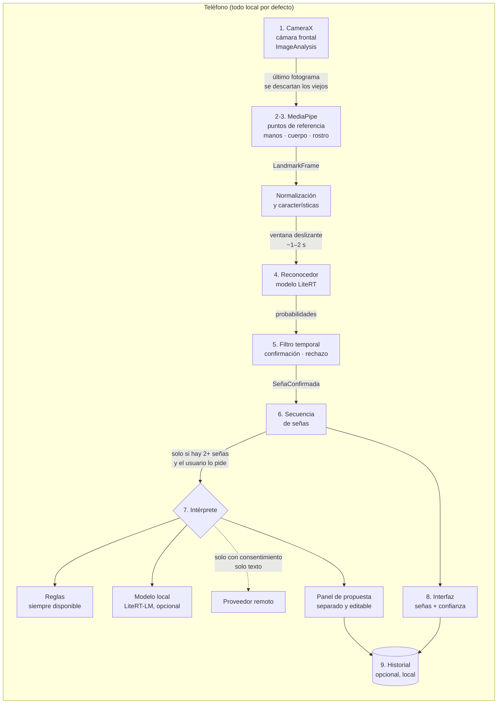

# 02 · Arquitectura

## Etapas del sistema



Principio rector: **el reconocedor visual y el intérprete solo se comunican mediante la secuencia
de señas confirmadas**. Se puede reentrenar o sustituir uno sin tocar el otro.

## Módulos de Gradle

| Módulo | Tipo | Responsabilidad | Depende de |
|---|---|---|---|
| `:app` | Android app | Navegación, inyección de dependencias, pantallas Compose | todos |
| `:core:model` ✅ | Kotlin puro | Tipos de dominio (`LandmarkFrame`, `Vocabulario`, `PrediccionSena`, `SenaConfirmada`, `PropuestaFrase`) y lector JSON | — |
| `:recognizer:api` ✅ | Kotlin puro | `ReconocedorSenas`, `Caracteristicas`, `ContratoModelo`, `LectorContrato`, `PostProcesador` | `:core:model` |
| `:sequence` ✅ | Kotlin puro | `VentanaTemporal`, `Remuestreo`, `FiltroTemporal`, `ConstructorSecuencia`, `MotorSenas` | `:core:model` |
| `:interpreter:api` ✅ | Kotlin puro | Interfaz `Interprete`, `PlantillaPrompt` y `ValidadorRespuesta` | `:core:model` |
| `:interpreter:rules` ✅ | Kotlin puro | `InterpreteReglas`: une significados sin inventar | `:interpreter:api` |
| `:camera` ✅ | Android lib | `ControladorCamara` (CameraX), `MedidorRendimiento` (fase 4) | — |
| `:vision:landmarks` ✅ | Android lib | `ExtractorLandmarks` (MediaPipe Holistic → `LandmarkFrame`), `Subconjuntos` (fase 5) | `:core:model` |
| `:recognizer:litert` ✅ | Android lib | `ReconocedorLiteRT` (CompiledModel), `CargadorReconocedor` (fase 7) | `:recognizer:api` |
| `:interpreter:litertlm` | Android lib | Modelo de lenguaje local con LiteRT-LM (fase 8) | `:interpreter:api` |
| `:data:history` | Android lib | Room, historial cifrado, borrado (fase 9) | `:core:model` |
| `:interpreter:remote` | Android lib | Proveedor remoto, desactivado por defecto (fase 10) | `:interpreter:api` |

✅ = ya creado (fases 3 a 7). Los módulos Android se crean en la fase que los necesita, para no
mantener módulos vacíos. El antiguo `:core:common` no hizo falta: el vocabulario vive en
`:core:model` y no se necesitan utilidades compartidas todavía.

Los identificadores del código van sin «ñ» (`SenaConfirmada`, `ReconocedorSenas`) para evitar
problemas de codificación en nombres de archivo y herramientas; los textos visibles sí la usan.

Los módulos **Kotlin puro** se prueban con JUnit en el ordenador, sin emulador. Ahí vive la lógica
que decide qué se muestra al usuario, así que es la parte con más pruebas.

## Contratos principales

```kotlin
/** Un fotograma convertido en puntos de referencia normalizados (sin imagen). */
data class LandmarkFrame(
    val timestampMs: Long,
    val manoIzquierda: List<Punto3D>?,   // 21 puntos o null si no se detecta
    val manoDerecha: List<Punto3D>?,
    val cuerpo: List<Punto3D>?,          // subconjunto del torso superior
    val rostro: List<Punto3D>?,          // subconjunto relevante (cejas, boca)
)

/** Seña del vocabulario: id estable ("lsc.gracias"), glosa, significado y tipo. */
data class EntradaVocabulario(
    val id: String, val glosa: String, val significado: String,
    val tipo: TipoSena,                  // LETRA, NUMERO, PALABRA
    val interrogativa: Boolean = false,
    val variante: String? = null,
)

/** Salida cruda del modelo para una ventana de fotogramas. */
data class PrediccionSena(
    val ventanaInicioMs: Long,
    val ventanaFinMs: Long,
    val candidatas: List<Candidata>,     // ordenadas por probabilidad
    val desconocida: Boolean,            // el modelo rechaza la entrada
)

/** Seña aceptada por el filtro temporal: es lo único que ve el intérprete. */
data class SenaConfirmada(
    val entrada: EntradaVocabulario,
    val confianza: Float,                // media de las ventanas que la confirmaron
    val inicioMs: Long,
    val finMs: Long,
)

interface ReconocedorSenas : AutoCloseable {
    val vocabulario: Vocabulario
    val ficha: FichaModelo
    val fotogramasPorVentana: Int
    suspend fun predecir(ventana: List<LandmarkFrame>): PrediccionSena
}

interface Interprete {
    val origen: OrigenInterpretacion     // REGLAS, LOCAL, REMOTO
    suspend fun proponer(secuencia: List<SenaConfirmada>, contexto: String? = null): PropuestaFrase
}
```

### Contrato del intérprete (salida validada)

El modelo de lenguaje debe responder con este JSON. Si no cumple el esquema, o usa un `id` que no
está en la secuencia de entrada, la respuesta **se descarta** y se muestra la del intérprete de
reglas.

```json
{
  "propuesta": "Hola, ¿cómo estás?",
  "senas_usadas": ["lsc.hola", "lsc.como", "lsc.estar"],
  "incierta": true,
  "motivo": "La seña COMO tuvo confianza baja (0,58).",
  "pregunta_aclaracion": "¿Quisiste preguntar cómo está la otra persona?"
}
```

Reglas fijas, independientes del modelo que se use:

- Con **una sola seña** no se llama al modelo de lenguaje: se muestra su significado.
- Las señas con confianza por debajo del umbral se marcan como inciertas y el modelo lo sabe.
- El modelo puede reordenar las señas (la gramática de la LSC no sigue el orden del español),
  pero no usar una seña más veces de las reconocidas. Si omite alguna, debe marcar la propuesta
  como incierta y explicar por qué.
- `ValidadorRespuesta` (`:interpreter:api`) comprueba todas estas reglas; está probado.
- La propuesta nunca sustituye la secuencia reconocida: ambas se ven a la vez.
- Una corrección del usuario es definitiva; la IA no la vuelve a modificar.

## Concurrencia y rendimiento

- `ImageAnalysis` en modo `STRATEGY_KEEP_ONLY_LATEST`: si el análisis va atrasado, se descartan
  los fotogramas viejos en lugar de encolarlos.
- Resolución de análisis baja (del orden de 480p); la vista previa va por separado.
- Un único hilo para MediaPipe y otro para el reconocedor, comunicados por un `Channel` de
  capacidad 1 con `DROP_OLDEST`.
- El reconocedor solo se ejecuta cuando hay manos en la ventana y a una frecuencia limitada
  (no en cada fotograma).
- El modelo de lenguaje se carga bajo demanda, se libera al salir de la pantalla y se ofrece solo
  si el dispositivo tiene memoria suficiente.
- Todo se cancela con el ciclo de vida de la pantalla (`viewModelScope`, `lifecycleScope`).

## Privacidad por diseño

- Las imágenes nunca salen de la etapa 2: después solo circulan coordenadas.
- No se guardan imágenes ni vídeos. El historial guarda texto y, de forma opcional, glosas.
- El intérprete remoto recibe **solo glosas y confianzas**, nunca imágenes ni puntos de referencia,
  y solo si el usuario lo activa.
