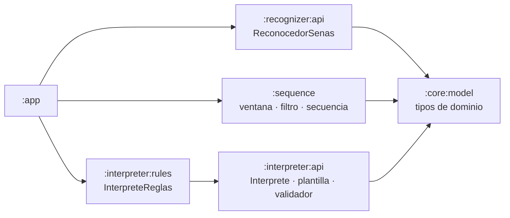

# Fase 3 · Estructura modular

## Qué incluye

Cinco módulos **Kotlin puro** (sin Android) con la lógica que decide qué ve el usuario. Se prueban
en el ordenador con JUnit, sin teléfono ni emulador.



El reconocedor y el intérprete **no dependen entre sí**: solo comparten los tipos de
`:core:model`. Es lo que permite cambiar uno sin tocar el otro.

| Módulo | Archivos principales | Qué hace |
|---|---|---|
| `:core:model` | `Landmarks.kt`, `Vocabulario.kt`, `Reconocimiento.kt`, `Interpretacion.kt` | Tipos con validación en el constructor: 21 puntos por mano, probabilidades entre 0 y 1, candidatas ordenadas, ids con prefijo de lengua (`lsc.`), propuesta incierta con motivo obligatorio |
| `:recognizer:api` | `ReconocedorSenas.kt` | Contrato que implementará el modelo LiteRT (fase 7) y su ficha (datos de entrenamiento, versión) |
| `:sequence` | `VentanaDeslizante.kt` | Ventanas solapadas (p. ej. 30 fotogramas cada 10); descarta las que no tienen manos sin llamar al modelo |
| | `FiltroTemporal.kt` | Confirma una seña solo tras 3 ventanas seguidas con confianza ≥ 0,70 y margen ≥ 0,15 sobre la segunda candidata; no la repite mientras se mantiene |
| | `ConstructorSecuencia.kt` | Acumula señas y cierra la frase tras 1,2 s sin manos, por botón o al llegar a 20 señas |
| `:interpreter:api` | `Interprete.kt`, `PlantillaPrompt.kt`, `ValidadorRespuesta.kt` | Contrato común, instrucciones para el modelo de lenguaje y validador que rechaza señas inventadas |
| `:interpreter:rules` | `InterpreteReglas.kt` | Intérprete sin IA generativa: une significados, agrupa letras deletreadas, marca la incertidumbre |

Los umbrales (0,70, 0,15, 3 ventanas, 1,2 s, 0,75 para «seña dudosa») son **provisionales**. Se
calibran en la fase 11 con datos de personas que el modelo no vio en el entrenamiento.

## Decisiones

- **Rechazar antes que adivinar.** Cualquier ventana desconocida, ambigua o de baja confianza corta
  la racha del filtro. Es preferible no mostrar una seña a mostrar una equivocada.
- **Repetir una seña a propósito** (la doble L de LLAVE) es posible: basta con bajar la mano dos
  ventanas (unos 0,7 s). Una sola ventana de ruido no cuenta como repetición.
- **El validador es la garantía de no inventar.** El modelo de lenguaje puede reordenar las
  señas, porque la LSC no sigue el orden del español, pero:
  - no puede usar identificadores que no se reconocieron;
  - no puede usar una seña más veces de las que se hizo;
  - si omite alguna, o hay señas de baja confianza, debe marcar la propuesta como incierta y
    explicar por qué.

  Si falla cualquiera de estas reglas, se muestra la propuesta del intérprete por reglas.
- **Una sola seña nunca pasa por el modelo de lenguaje**: se muestra su significado («Gracias»),
  sin convertirlo en oración.
- **Configuración común en un solo sitio.** El `build.gradle.kts` raíz aplica JVM 17 y JUnit a
  todos los módulos Kotlin puros, así sus archivos de construcción quedan en 3–8 líneas.
- **Grupo de Maven por carpeta** (`com.lhansqw.senaslsc.recognizer`,
  `com.lhansqw.senaslsc.interpreter`…), para que `:recognizer:api` e `:interpreter:api`, que
  comparten el nombre `api`, no se confundan al resolver dependencias.

## Pruebas

| Clase | Pruebas | Qué cubre |
|---|---|---|
| `ModeloTest` | 7 | Validaciones de los tipos de dominio |
| `ReconocedorSenasTest` | 3 | Tamaño y orden de la ventana |
| `VentanaDeslizanteTest` | 4 | Emisión por paso, descarte sin manos, reinicio, orden |
| `FiltroTemporalTest` | 10 | Confirmación, baja confianza, ambigüedad, desconocida, vocabulario, repetición |
| `ConstructorSecuenciaTest` | 6 | Cierre por pausa, por botón y por máximo; corrección |
| `PlantillaPromptTest` | 5 | Contenido de las instrucciones, formato decimal, contexto |
| `ValidadorRespuestaTest` | 8 | Señas inventadas, repetidas u omitidas; incertidumbre; longitud |
| `InterpreteReglasTest` | 8 | Seña aislada, frase, deletreo, pregunta, incertidumbre |
| `EvaluadorCapacidadTest` (app) | 7 | De la fase 2 |
| `FlujoSimuladoTest` (app) | 1 | Predicciones → filtro → secuencia → propuesta, de principio a fin |
| **Total** | **59** | |

## Cómo comprobar que funciona

```bash
git pull
./gradlew test          # Windows: gradlew.bat test
```

Resultado esperado: `BUILD SUCCESSFUL` y 59 pruebas superadas. Cada módulo genera su informe en
`<módulo>/build/reports/tests/test/index.html` (en `:app`:
`app/build/reports/tests/testDebugUnitTest/index.html`).

En Android Studio, al sincronizar, el panel *Project* debe mostrar los módulos `core`,
`recognizer`, `sequence` e `interpreter`. Puedes ejecutar las pruebas de un módulo con clic
derecho sobre su carpeta `src/test` → *Run 'Tests in …'*.

La app se ve igual que en la fase 2: esta fase no cambia la interfaz.

## Qué se verificó antes de subir

- Cada módulo se compiló **por separado**, en orden de dependencias y solo con las que declara su
  `build.gradle.kts` (así se comprueba que no usa nada que no tenga declarado), con
  Kotlin 2.4.20 y avisos tratados como errores (`-Werror`).
- Las 59 pruebas se ejecutaron: todas correctas.
- La sincronización de Gradle con AGP **no se pudo ejecutar** en el entorno donde se preparó el
  commit (sin acceso a los repositorios de Google y Maven). Se comprueba con `./gradlew test`.
