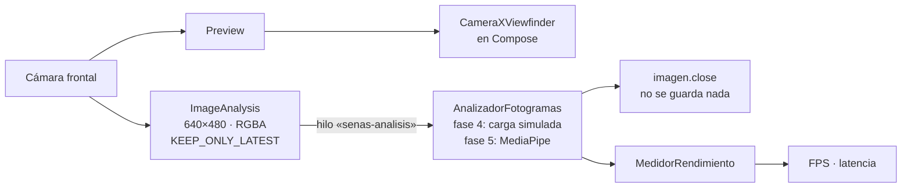

# Fase 4 · Cámara con CameraX

## Qué incluye

| Archivo | Qué hace |
|---|---|
| `camera/build.gradle.kts` | Primer módulo de librería Android. CameraX 1.6.2 (`camera-core`, `camera2`, `lifecycle`) |
| `camera/src/main/AndroidManifest.xml` | Declara el permiso `CAMERA` y que la app necesita alguna cámara |
| `camera/.../ControladorCamara.kt` | Vista previa + análisis en segundo plano, cámara frontal (trasera si no hay frontal), pausa y liberación de recursos |
| `camera/.../MedidorRendimiento.kt` | FPS y latencia del análisis sobre el último segundo (Kotlin puro, con pruebas) |
| `app/.../permisos/EstadoPermiso.kt` | Decide qué mostrar según el estado del permiso (Kotlin puro, con pruebas) |
| `app/.../permisos/PermisoCamara.kt` | Explica el uso de la cámara, la pide y, si está bloqueada, lleva a los ajustes |
| `app/.../camara/PantallaCamara.kt` | Vista previa con `CameraXViewfinder`, métricas, pausar y volver |
| `app/.../camara/CamaraViewModel.kt` | Conserva la cámara al girar el teléfono; carga simulada para pruebas |
| `MainActivity.kt`, `PantallaInicio.kt` | Botón «Abrir cámara» y navegación entre las dos pantallas |

## Cómo funciona



- **Dos salidas independientes.** La vista previa va directa a la pantalla. El análisis recibe
  fotogramas pequeños (640×480): MediaPipe no necesita más y una resolución mayor solo gasta
  batería.
- **Descarte de fotogramas.** `STRATEGY_KEEP_ONLY_LATEST`: si el análisis va lento, CameraX se
  queda solo con el fotograma más reciente y descarta los intermedios. La latencia no crece y la
  vista previa sigue fluida.
- **Formato RGBA_8888.** Preparado para MediaPipe (fase 5), sin convertir desde YUV.
- **Un solo hilo de análisis**, que se crea al abrir la cámara y se cierra al salir.
- **Ciclo de vida.** La cámara se vincula al ciclo de vida de la pantalla: al pasar la app a
  segundo plano se apaga sola (se apaga el indicador de cámara del sistema) y al volver se
  reanuda. Al girar el teléfono, el `ViewModel` conserva los casos de uso y solo se vuelven a
  vincular.
- **Privacidad.** Cada imagen se cierra nada más analizarla. No se guarda ni se envía ninguna.

### Permiso de cámara

| Situación | Lo que ve el usuario |
|---|---|
| Primera vez | Para qué se usa la cámara y aviso de privacidad → «Permitir cámara» |
| Lo rechazó una vez | Explicación de que sin cámara no hay reconocimiento → «Permitir cámara» o «Volver» |
| Bloqueado («No volver a preguntar») | Cómo activarlo → «Abrir ajustes». Al volver de los ajustes se comprueba de nuevo, sin reiniciar la app |

## Cómo comprobar que funciona

```bash
git pull
gradlew.bat test
```

Resultado esperado: `BUILD SUCCESSFUL`, 68 pruebas (5 nuevas de `MedidorRendimientoTest` y
4 de `EstadoPermisoTest`).

Después, ejecuta la app en el teléfono (▶ *Run 'app'*) y comprueba:

1. **Permiso.** Pulsa «Abrir cámara».
   - Rechaza el permiso: debe aparecer la explicación.
   - Recházalo otra vez: debe aparecer «Abrir ajustes».
   - Actívalo en los ajustes y vuelve: debe abrirse la cámara sin reiniciar la app.

   Para repetir la prueba desde cero, desinstala la app o quita el permiso en los ajustes.
2. **Vista previa.** Se ve la cámara frontal, como un espejo. El panel indica
   «Cámara frontal», la resolución de análisis (normalmente 640×480) y unos 30 FPS de análisis
   (algunos teléfonos dan 15 o 24 con poca luz) con latencia cercana a 0 ms.
3. **Descarte de fotogramas.** En «Carga simulada» elige **150 ms**. Los FPS de análisis bajan a
   unos 6 y la latencia sube a unos 150 ms, **pero la vista previa sigue igual de fluida**. Eso
   demuestra que los fotogramas atrasados se descartan en lugar de acumularse. Vuelve a 0 ms y
   los FPS se recuperan en un segundo.
4. **Pausa.** «Pausar análisis»: el panel dice «Análisis en pausa» y la vista previa sigue.
5. **Ciclo de vida.** Pulsa el botón de inicio del teléfono: el indicador verde de cámara de
   Android se apaga. Vuelve a la app: la vista previa se recupera. Gira el teléfono: la cámara
   sigue funcionando.
6. **Volver.** «Volver» o el gesto atrás regresan al inicio y apagan la cámara.

La carga simulada solo aparece en las compilaciones de depuración; en la versión final no está.

## Qué se verificó antes de subir

- `MedidorRendimiento` y `EstadoPermiso` se compilaron con Kotlin 2.4.20 y avisos como errores,
  y sus pruebas, junto con las 59 anteriores, se ejecutaron: 68 correctas.
- El código Android (CameraX, Compose) se revisó a mano y se pasó por el compilador para detectar
  errores de sintaxis y de tipos propios. **No se pudo compilar entero** en el entorno donde se
  preparó el commit, porque no tiene acceso a los repositorios de Google. La compilación completa
  y la prueba en el teléfono se hacen con los pasos de arriba.
