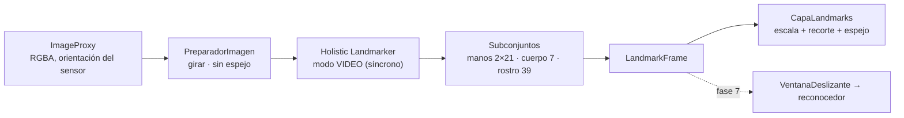

# Fase 5 · MediaPipe: puntos de manos, cuerpo y rostro

## Qué incluye

| Archivo | Qué hace |
|---|---|
| `vision/landmarks/build.gradle.kts` | Módulo `:vision:landmarks` con `tasks-vision` 1.1.1 y la tarea que descarga el modelo |
| `vision/.../ExtractorLandmarks.kt` | MediaPipe Holistic Landmarker en modo VIDEO → `LandmarkFrame` |
| `vision/.../Subconjuntos.kt` | Qué puntos del cuerpo y del rostro se guardan, y las conexiones para dibujar (Kotlin puro, con pruebas) |
| `app/.../camara/PreparadorImagen.kt` | Fotograma RGBA → mapa de bits vertical sin espejo, reutilizando memoria |
| `app/.../camara/AnalizadorLandmarks.kt` | Une cámara y MediaPipe; carga el modelo y publica el último resultado |
| `app/.../camara/Geometria.kt` | Paso de coordenadas de la imagen a la pantalla (recorte y espejo; Kotlin puro, con pruebas) |
| `app/.../camara/CapaLandmarks.kt` | Dibuja manos, brazos y rostro sobre la vista previa |
| `camera/.../ControladorCamara.kt` | Ahora fija la relación 4:3 en la vista previa y en el análisis |

## Cómo funciona



### Decisiones

- **Modo VIDEO en lugar de LIVE_STREAM.** El modo VIDEO devuelve el resultado en la misma
  llamada, así que la latencia que se mide es exactamente la del fotograma. El control de carga
  ya lo hace CameraX (fase 4): si MediaPipe tarda, los fotogramas viejos se descartan antes de
  llegar.
- **MediaPipe recibe la imagen sin espejo.** Con la cámara frontal, la vista previa se ve como un
  espejo, pero el modelo recibe la imagen tal como la capta la cámara. Así «mano izquierda» es la
  mano izquierda real de la persona, igual que en los vídeos de los conjuntos de datos. El espejo
  solo se aplica al dibujar. **El entrenamiento (fase 6) debe seguir la misma regla.**
- **Subconjuntos fijos** (`Subconjuntos.VERSION = 1`):
  - manos completas (21 puntos cada una);
  - del cuerpo, nariz, hombros, codos y muñecas (7 puntos);
  - del rostro, labios, cejas, ojos y nariz (39 de los 478 puntos).

  Son la entrada del modelo de la fase 6. Si se cambian, hay que volver a extraer y reentrenar.
- **Mismo campo de visión.** La vista previa y el análisis van en 4:3. La capa de puntos aplica
  la misma escala y el mismo recorte que la vista previa, por eso los puntos caen encima de las
  manos.
- **Memoria.** Los mapas de bits se reutilizan entre fotogramas: sin eso se generarían unos
  70 MB de basura por segundo a 30 FPS.
- **El modelo no está en git.** La tarea de Gradle `descargarModeloHolistic` lo baja de la URL
  oficial de Google la primera vez que se compila (unos MB) y comprueba que el archivo es válido.
- **CPU por defecto.** La aceleración por GPU se mide en la fase 11.

## Cómo comprobar que funciona

```bash
git pull
gradlew.bat test
```

Resultado esperado: `BUILD SUCCESSFUL` y 77 pruebas (9 nuevas: `SubconjuntosTest` y
`GeometriaTest`).

La primera compilación muestra `Descargando https://storage.googleapis.com/...` y después
`Modelo guardado en .../vision/landmarks/src/main/assets/holistic_landmarker.task`. Si no tienes
Internet en ese momento la compilación falla con un mensaje claro; vuelve a compilar con conexión.
También puedes lanzar la descarga sola con `gradlew.bat descargarModeloHolistic`.

En el teléfono:

1. **Carga del modelo.** Abre la cámara. Durante un instante el panel dice «MediaPipe: cargando
   modelo…» y después muestra el tiempo por fotograma.
2. **Manos.** Pon las manos delante de la cámara: deben aparecer sus 21 puntos unidos por
   líneas, siguiendo los dedos en tiempo real. El panel debe decir `Manos: 1` o `Manos: 2`.
3. **Lado correcto.** Levanta **solo tu mano izquierda**: debe dibujarse en **turquesa** (y la
   derecha en naranja). Si los colores salen al revés, avísame: significaría que la regla del
   espejo no se cumple en tu teléfono.
4. **Cuerpo y rostro.** Deben verse líneas en hombros y brazos, puntos en cejas, ojos y boca, y el
   panel debe decir `Cuerpo: sí · Rostro: sí`.
5. **Alineación.** Los puntos deben caer encima de las manos y no desplazados. Prueba también con
   el teléfono girado.
6. **Latencia.** Anota los valores de «MediaPipe: … ms» y «Análisis: … FPS» de tu teléfono. Son
   la referencia para la fase 11. Como orientación, en gama media se esperan unas pocas decenas
   de milisegundos, pero depende mucho del procesador.
7. **Pausa.** «Pausar análisis» borra los puntos; al reanudar vuelven.

Si aparece «No se pudo cargar el modelo de MediaPipe», comprueba que existe
`vision/landmarks/src/main/assets/holistic_landmarker.task` y vuelve a compilar.

## Qué se verificó antes de subir

- La API de Holistic Landmarker se comprobó en el **código fuente** de MediaPipe (firmas de
  `HolisticLandmarkerOptions.Builder`, `detectForVideo`, `HolisticLandmarkerResult`). La versión
  1.1.1 y la URL del modelo se comprobaron en el ejemplo oficial de Google para Android.
- `Subconjuntos` y `Geometria` se compilaron con Kotlin 2.4.20 y avisos como errores. Sus
  pruebas, junto con las anteriores, se ejecutaron: 77 correctas.
- El código Android se revisó a mano y con el compilador (errores de sintaxis y de tipos
  propios). **No se pudo compilar entero ni descargar el modelo** en el entorno donde se preparó
  el commit, porque no tiene acceso a los repositorios de Google.
