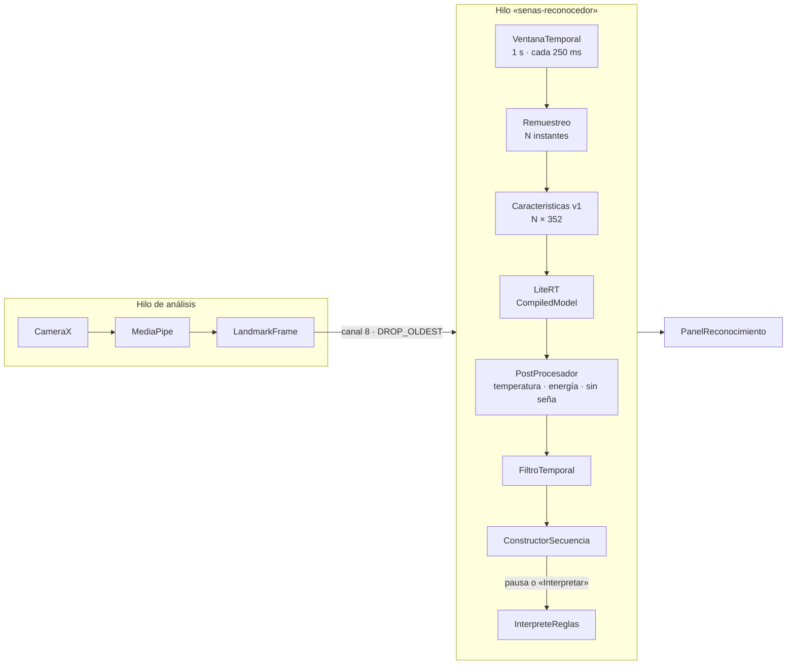

# Fase 7 · Reconocedor de señas con LiteRT

> El modelo todavía **no está entrenado** (fase 6, pospuesta). Esta fase deja lista toda la
> cadena (características, ventana, modelo, filtro, secuencia, interfaz) contra un **contrato de
> modelo** fijo. Sin modelo, la app lo indica y no muestra señas.

## Flujo completo



## El contrato del modelo

El modelo entrenado en la fase 6 debe cumplir esto. La app lo comprueba al arrancar.

### 1. Ventana temporal y remuestreo

- La ventana cubre los últimos `ventana.duracion_ms` milisegundos (por defecto 1 000) y se evalúa
  cada 250 ms, solo si al menos la mitad de los fotogramas tienen alguna mano.
- Se remuestrea a `ventana.fotogramas` instantes equiespaciados, desde `fin − duración` hasta
  `fin`. Para cada instante se toma el fotograma más cercano y, en caso de empate, el anterior
  (`sequence/.../Remuestreo.kt`).
- Así el modelo ve siempre la misma duración, tanto si la cámara va a 6 FPS como a 30.

### 2. Características (versión 1, 352 por fotograma)

Implementadas en `recognizer/api/.../Caracteristicas.kt`; las pruebas fijan su orden.

| Bloque | Valores | Contenido |
|---|---|---|
| Mano izquierda | 127 | presencia · 21×(x, y, z) respecto a los hombros · 21×(x, y, z) respecto a la muñeca, escalados por el tamaño de la mano |
| Mano derecha | 127 | igual |
| Cuerpo | 15 | presencia · 7×(x, y) respecto a los hombros |
| Rostro | 79 | presencia · 39×(x, y) respecto a los hombros |
| Velocidad | 4 | (vx, vy) de cada muñeca, en unidades de referencia por segundo |

- **Referencia:** x se multiplica por la relación de aspecto. El origen es el punto medio de los
  hombros y la escala, la distancia entre hombros. Sin cuerpo: centro de la imagen y escala 0,25.
- Todo lo no detectado vale 0, con su presencia a 0.
- «Izquierda» es la mano izquierda real de la persona (imagen sin espejo, fase 5).

### 3. Modelo LiteRT

- Archivo `recognizer/litert/src/main/assets/reconocedor_lsc.tflite`.
- Entrada `float32[1, fotogramas, 352]`. Salida `float32[1, etiquetas]` con **logits**, sin softmax.
- Al cargarlo, la app lo ejecuta una vez con ceros y comprueba que la salida tiene tantos valores
  como etiquetas.

### 4. Salida y rechazo de desconocidas

- Probabilidades: softmax de `logits / temperatura` (temperatura calibrada con validación).
- La clase `etiqueta_sin_sena` (movimientos que no son señas) nunca se muestra como seña.
- La entrada es **desconocida** si gana esa clase o si la energía `−T·log Σ exp(logit/T)` supera
  `umbral_energia`. Una entrada desconocida no se confirma nunca.
- Después actúa el filtro temporal de la fase 3: 3 ventanas seguidas con confianza ≥ 0,70 y
  margen ≥ 0,15.

### 5. `modelo.json`

Ejemplo completo en [`docs/modelo.ejemplo.json`](modelo.ejemplo.json).

| Campo | Significado |
|---|---|
| `formato` | Versión del formato del archivo: 1 |
| `nombre`, `version`, `lengua` | Identificación del modelo (`lengua`: prefijo de los ids, p. ej. `lsc`) |
| `caracteristicas.version` / `.version_subconjuntos` / `.por_fotograma` | Deben valer 1 / 1 / 352 |
| `caracteristicas.usa_rostro` (opcional) | `false` si el modelo se entrenó sin caras (LSC70 las difumina): la app pone a cero los puntos del rostro. Si falta, `true` |
| `ventana.fotogramas` / `.duracion_ms` | Instantes por ventana y duración que cubren |
| `salida.etiquetas` | Id de cada salida del modelo, en orden |
| `salida.etiqueta_sin_sena` | Etiqueta de la clase «sin seña», o `null` |
| `salida.temperatura` | Temperatura de calibración (> 0) |
| `salida.umbral_energia` | Umbral de energía, o `null` para no usarlo |
| `vocabulario[]` | Por cada seña: `id`, `glosa`, `significado`, `tipo` (`letra`/`numero`/`palabra`), `interrogativa`, `variante` |
| `datos_entrenamiento[]` | Conjuntos usados, con su licencia |
| `metricas` | Métricas con personas no vistas (`exactitud`, `macro_f1`, `rechazo_desconocidas`); se muestran en la app |

## Qué ve el usuario

| Situación | Panel |
|---|---|
| Sin modelo (ahora) | «Reconocedor de señas no instalado», con la explicación. Cámara y MediaPipe siguen funcionando |
| Modelo incompatible | Lista de problemas (p. ej. otra versión de características) |
| Modelo listo | Nombre, versión y métricas; «Viendo: HOLA 82 %»; señas confirmadas con su confianza; propuesta por reglas; botones *Borrar última*, *Limpiar* e *Interpretar* |

La propuesta va siempre aparte y lleva su origen («Propuesta (reglas, sin IA generativa)»).
Las señas confirmadas y la propuesta se anuncian a TalkBack.

## Pruebas nuevas

| Clase | Qué cubre |
|---|---|
| `CaracteristicasTest` | Tamaños, referencia, invariancia a la distancia, forma de la mano, aspecto, velocidad |
| `VentanaTemporalTest`, `RemuestreoTest` | Ventana por tiempo a 6 y 30 FPS, vecino más cercano, empates |
| `ContratoModeloTest`, `LectorContratoTest` | Compatibilidad y errores por campo de `modelo.json` |
| `PostProcesadorTest` | Softmax estable, temperatura, energía, clase sin seña |
| `MotorSenasTest`, `CoordinadorReconocimientoTest` | Flujo completo con un modelo falso: confirmación, pausa, interpretar, borrar |
| `LectorJsonTest` | Lector JSON propio (también para la fase 8) |
| `FormatoTest`, `CoherenciaContratoTest` | Formato en español; subconjuntos y características coherentes |

## Cómo comprobar que funciona

```bash
git pull
gradlew.bat test
```

Resultado esperado: `BUILD SUCCESSFUL` y 147 pruebas.

En el teléfono, al abrir la cámara, debe aparecer debajo de las métricas el panel «Reconocedor de
señas no instalado». Los puntos de MediaPipe se siguen dibujando. Si quieres comprobar el aviso de
modelo incompatible, copia `docs/modelo.ejemplo.json` como
`recognizer/litert/src/main/assets/modelo.json` (sin `.tflite`): la app debe decir que falta
`reconocedor_lsc.tflite`. Después borra ese archivo.

## Qué se verificó antes de subir

- La API de LiteRT (`CompiledModel.create(assets, ruta, Options, Environment)`, búferes,
  `writeFloat`/`readFloat`, cierre) se comprobó en la guía oficial de Android.
- Toda la lógica pura se compiló con Kotlin 2.4.20 y avisos como errores. Las 147 pruebas pasan.
- El código Android (LiteRT, corrutinas, Compose) se revisó a mano y con el compilador. **No se
  pudo compilar entero ni ejecutar un modelo real** en el entorno donde se preparó el commit.
