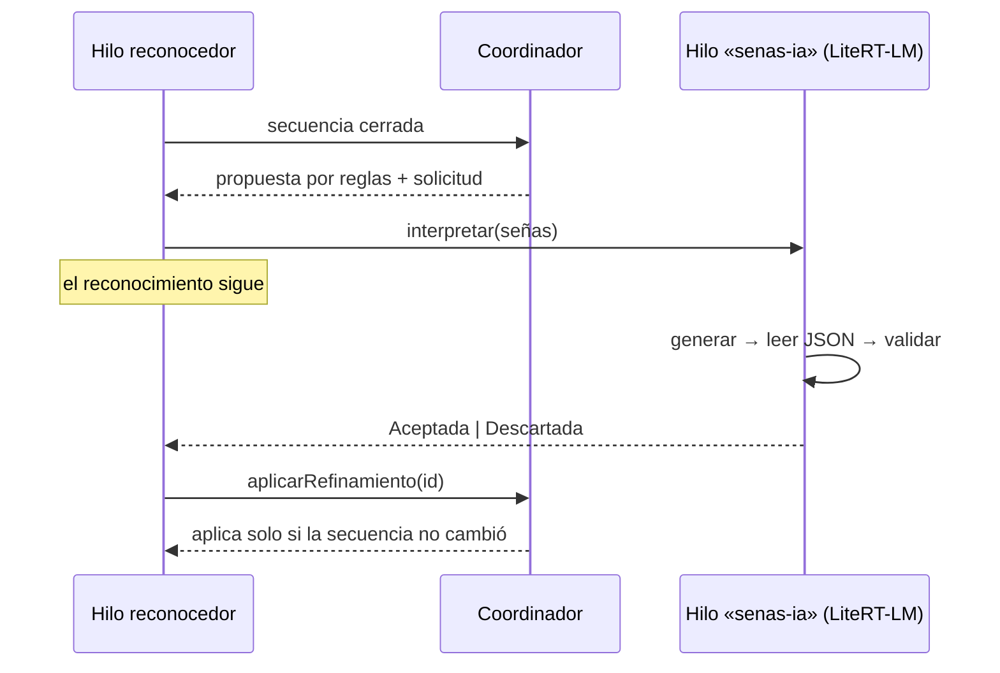

# Fase 8 · Modelo de lenguaje en el teléfono (LiteRT-LM)

## Qué hace

Cuando se cierra una frase de dos o más señas:

1. Aparece **al instante** la propuesta por reglas (fase 3).
2. Si la IA local está instalada y activada, se le pide una frase más natural **en su propio
   hilo**. Mientras tanto el reconocimiento sigue y el panel dice «La IA del teléfono está
   preparando una frase…».
3. La respuesta se **lee** (JSON) y se **valida** (no puede usar señas no reconocidas ni repetirlas;
   debe marcar la incertidumbre). Si todo es correcto, sustituye a la de reglas y se etiqueta
   «Propuesta de la IA en el teléfono».
4. Si falla o no supera la validación, se queda la de reglas y se muestra el motivo.
5. Si el usuario corrige la frase mientras la IA trabaja, el resultado que llega tarde se descarta.

Con **una sola seña** nunca se consulta al modelo: se muestra su significado.



## Modelo

| | |
|---|---|
| Modelo | Gemma 4 E2B (instrucciones), formato `.litertlm` |
| Licencia | Apache 2.0 |
| Tamaño | unos 2,6 GB |
| Origen | `huggingface.co/litert-community/gemma-4-E2B-it-litert-lm` |
| Referencia publicada | Samsung S26 Ultra, CPU: ~47 tokens/s, ~1,7 GB de RAM |
| Motor | LiteRT-LM 0.18.1 (`litertlm-android`), CPU |
| Requisito en la app | `EvaluadorCapacidad.interpreteLocal` (≈ 6 GB de RAM; se ajustará con mediciones) |

Cada petición abre una conversación nueva con las instrucciones del contrato (`PlantillaPrompt`)
como mensaje de sistema. Usa temperatura 0,2, porque se busca fidelidad a las señas y no
creatividad, y un tiempo máximo de 30 s, pasado el cual se cancela.

## Instalación del modelo

Pantalla **Inicio → IA para proponer frases**:

- **Descargar**: antes de empezar se pide consentimiento, indicando el tamaño, el aviso de datos
  móviles y la licencia, con enlace a la ficha del modelo.
  - Se comprueba que haya espacio: el tamaño restante más un margen del 10 % (mínimo 200 MB).
  - Se ven los bytes descargados, la velocidad y el tiempo restante.
  - La descarga es **reanudable**: si se corta o se cancela, «Continuar descarga» sigue desde
    donde quedó (cabecera `Range`).
- **Importar archivo**: para quien descargue el `.litertlm` en otro equipo. Se comprueban la
  extensión y el tamaño antes de copiar.
- **Usar para proponer frases**: interruptor. Se activa solo al terminar una instalación y está
  desactivado por defecto.
- **Eliminar modelo**: pide confirmación y libera el espacio.

El modelo se guarda en el almacenamiento privado de la app (`files/modelos/`), excluido de las
copias de seguridad. El permiso de Internet se usa **solo** para esta descarga.

En un teléfono sin memoria suficiente, la pantalla lo explica y desactiva la instalación.

## Código nuevo

| Módulo | Archivo | Qué hace |
|---|---|---|
| `:interpreter:api` | `LectorRespuestaModelo.kt` | JSON de la respuesta, tolerante a texto alrededor |
| | `InterpreteGenerativo.kt` | Genera → lee → valida → o respaldo por reglas |
| `:core:descargas` (nuevo) | `Reanudacion.kt` | Decisiones según 200/206/416/4xx/5xx y `Content-Range` |
| | `DescargadorArchivo.kt` | Descarga HTTP reanudable con archivo `.parcial` |
| | `CopiaArchivo.kt` | Copia con progreso, todo o nada |
| | `Progreso.kt`, `Formato.kt` | Velocidad, tiempo restante, espacio, tamaños en español |
| `:interpreter:litertlm` (nuevo) | `MotorLiteRtLm.kt` | LiteRT-LM: motor, conversación por petición, tiempo máximo |
| | `GestorModeloLenguaje.kt` | Estados del archivo, descarga, importación, espacio |
| | `ModelosLenguaje.kt` | Descriptor de Gemma 4 E2B |
| `:app` | `ia/ControladorIaLocal.kt` | Carga el modelo en el hilo «senas-ia» y lo libera |
| | `ia/PantallaIa.kt`, `ia/IaViewModel.kt` | Pantalla de instalación y preferencia |
| | `SenasApp.kt` | Mantiene la descarga viva al cambiar de pantalla |
| | `reconocimiento/CoordinadorReconocimiento.kt` | Solicitudes y aplicación segura del resultado |

## Pruebas nuevas (193 en total)

- `LectorRespuestaModeloTest`, `InterpreteGenerativoTest`: respuestas válidas, inventadas, rotas,
  excepciones y una sola seña.
- `CoordinadorReconocimientoTest`: solicitudes, respuestas aceptadas, descartadas y **tardías**.
- `ReanudacionTest`, `ProgresoTest`, `FormatoTest`: lógica de descarga.
- `DescargadorArchivoTest`: descargas **reales** contra un servidor HTTP local. Cubre la descarga
  completa, cancelar y continuar, un servidor que ignora `Range`, un parcial ya completo, errores
  404 y 503, y la importación de todo o nada.
- `EstadoIaLocalTest`, `ModelosLenguajeTest`.

## Cómo comprobar que funciona

```bash
git pull
gradlew.bat test
```

Resultado esperado: `BUILD SUCCESSFUL` y 193 pruebas.

En el teléfono (Wi-Fi recomendado):

1. **Inicio → IA para proponer frases.** Si el teléfono no tiene memoria suficiente, verás el
   aviso y los botones desactivados: es lo esperado.
2. **Descargar → confirmar.** Debe avanzar la barra con velocidad y tiempo restante.
3. **Reanudación.** Pulsa *Cancelar* a mitad: aparece «Descarga interrumpida… Puedes continuarla».
   *Continuar descarga* debe seguir desde ese punto, no desde cero.
4. **Instalado.** Al terminar: «Instalado (2,5 GB)» y el interruptor activado.
5. **Uso.** Sin modelo de señas (fase 6) la IA no tiene frases que mejorar. Lo que sí puedes
   comprobar es que la cámara no pierde fluidez con la IA activada: el modelo se carga en segundo
   plano al abrir la cámara.
6. **Eliminar.** Libera el espacio y desactiva la IA.

## Limitaciones conocidas

- Si Android cierra la app en segundo plano, la descarga se detiene; al volver se puede continuar.
  Una descarga en primer plano con notificación se valorará en la fase 11.
- Solo CPU por ahora; la GPU (más rápida y con menos RAM según la ficha) se mide en la fase 11.
- La calidad de las frases se evaluará cuando haya modelo de señas, con una muestra revisada por
  personas.

## Qué se verificó antes de subir

- La API de LiteRT-LM se comprobó en su **guía oficial y su código fuente**: `EngineConfig`,
  `Backend.CPU`, `ConversationConfig(systemInstruction, samplerConfig)`, `SamplerConfig(topK: Int,
  topP: Double, temperature: Double)`, `sendMessage`, `cancelProcess` y `close`. Las versiones
  de LiteRT-LM (0.18.1) y `kotlinx-coroutines` (1.11.0) se comprobaron en las etiquetas oficiales
  de sus repositorios.
- Lógica pura y descargas: compiladas con Kotlin 2.4.20 y ejecutadas (193 pruebas correctas). La
  descarga se probó de verdad contra un servidor HTTP local.
- El código Android se revisó a mano y con el compilador. **No se pudo compilar entero ni ejecutar
  el modelo de lenguaje** en el entorno donde se preparó el commit.
